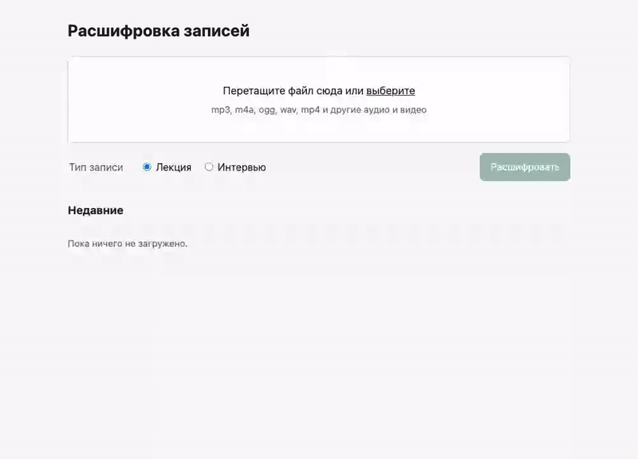

# voice-to-doc

[English version](README.md)

**Превращает запись лекции или интервью в структурированный документ:** краткая выжимка, почти дословный текст по разделам с таймкодами, а для интервью — реплики с подписями. Скачивается в Word или Markdown.

Работает локально на слабом ноутбуке и ничего не стоит: распознавание речи и редактура текста идут через бесплатный тариф Groq.



## Зачем

Сырая расшифровка — это сплошная стена текста с «э-э» и без структуры. Вручную превратить часовую лекцию в читаемый конспект — несколько часов работы. Инструмент делает это за минуты и сохраняет слова говорящего: чистит, но не пересказывает.

## Как устроено

```
загрузка ─► ffmpeg: моно 16 кГц, opus, куски по 10 минут
         ─► Groq Whisper large-v3: текст и таймкоды по каждому куску
         ─► Groq gpt-oss-120b: чистка, разделы / реплики (блоками)
         ─► выжимка ─► Markdown + .docx
```

Каждый шаг сохраняет результат в `data/<задание>/`, поэтому прерванное задание продолжается с первого незавершённого шага и не тратит лимит повторно.

## Инженерные решения

- **Работа в бесплатных лимитах.** Ограничитель на стороне клиента считает запросы и токены в минуту; бюджет ответа подбирается под размер блока, потому что Groq учитывает `max_completion_tokens` в лимите. Минутные лимиты пережидаются, дневной — ставит задание на паузу с кнопкой «Продолжить».
- **Ответам модели не доверяем.** JSON проверяется по схеме; выдуманные таймкоды привязываются к реальным; слишком короткий ответ (признак пересказа) переспрашивается со строгой инструкцией, а затем заменяется исходным текстом с пометкой.
- **Продолжение после сбоя.** Атомарная запись файлов, контрольные точки по кускам и блокам, атомарные переходы статусов, обработчик переживает упавшие задания.
- **Тесты.** ~100 офлайн-тестов (pytest, Groq подменён), живой сквозной тест на настоящем API, браузерная проверка Playwright в светлой и тёмной теме на компьютере и телефоне.

## Безопасность

Рассчитан на одного пользователя на своём компьютере:

- сервер слушает только `127.0.0.1`;
- запросы с чужим `Host` (DNS rebinding) и с других сайтов (CSRF) отклоняются;
- строгая Content-Security-Policy, никаких сторонних скриптов (рендерер Markdown лежит в проекте);
- ответ модели экранируется, остаются только ссылки `http(s)`;
- загрузки: белый список форматов, лимиты 2 ГБ и 6 часов, ffmpeg без плейлистов (нельзя подтянуть другие файлы с диска);
- ключ API хранится в `.env` с правами «только владелец», не пишется в журнал и не отдаётся через API;
- все версии зависимостей зафиксированы; CI проверяет их на известные уязвимости (`pip-audit`) и код статическим анализатором (`bandit`);
- независимый аудит безопасности не нашёл критичных, высоких и средних проблем; все низкие исправлены.

Подробнее — [SECURITY.md](SECURITY.md).

## Быстрый старт

Нужно: macOS или Linux, Python 3.12+, бесплатный [ключ Groq](https://console.groq.com/keys).

```bash
git clone https://github.com/OWNER/voice-to-doc.git
cd voice-to-doc
./run.sh            # создаст .venv, поставит зависимости, откроет http://127.0.0.1:8000
```

При первом запуске страница попросит ключ Groq. ffmpeg идёт в комплекте — больше ничего ставить не нужно.

Бесплатный тариф Groq (октябрь 2026): около 8 часов аудио и 200 тыс. токенов текста в сутки — примерно 3–4 часа записей.

## Разработка

```bash
.venv/bin/pip install -r requirements-dev.txt
.venv/bin/pytest                          # офлайн-тесты
.venv/bin/pytest -m live -s               # сквозной тест на настоящем Groq (macOS, использует `say`)
.venv/bin/python scripts/ui_check.py      # проверка в браузере + скриншоты
```

Проектные документы: [спецификация](docs/design/spec.md) и [план реализации](docs/design/implementation-plan.md), написанные до кода.

## Ограничения

- Роли в интервью определяются по смыслу, а не по голосу; надёжно только для двух собеседников.
- Редкие термины Whisper может распознать неверно (в демо «ARPANET» превратился в «Orpnet»).
- Рассчитан на русский язык; для других языков нужны другие `LANGUAGE` и промпты.

## Лицензия

[MIT](LICENSE)
